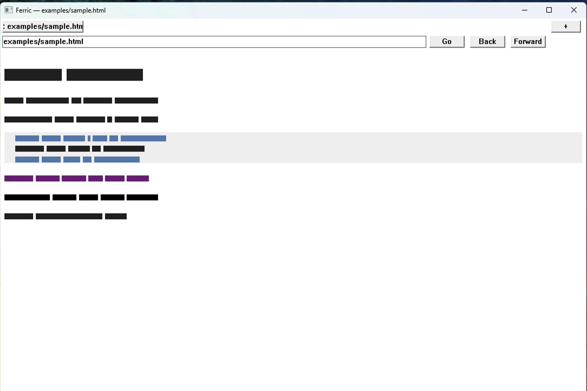
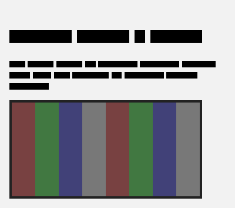
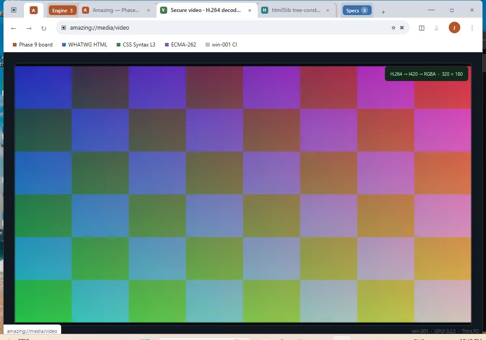
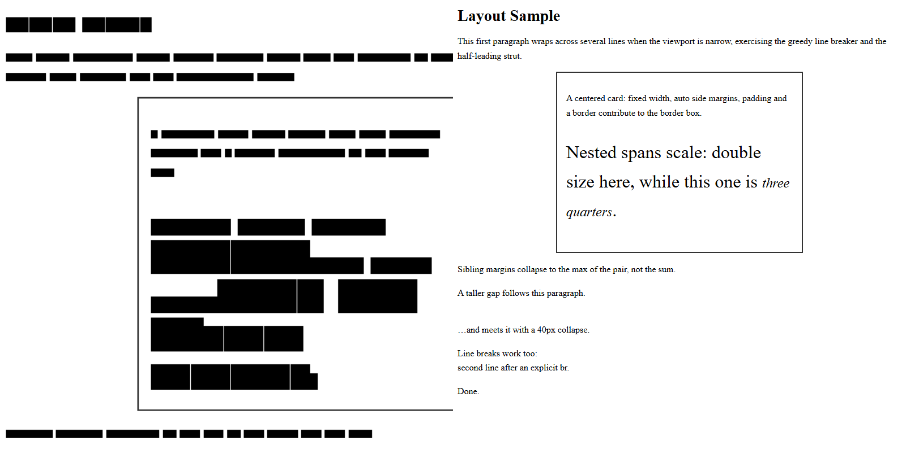

# Amazing

A from-scratch web browser engine in pure Rust — **zero third-party crates**
in every engine core component. Not a wrapper, not a fork, not a Chromium/
Servo/Ladybird embed.

## Why "Amazing"?

The name is a nod to [Andreas Kling's tweet](https://x.com/awesomekling/status/2090508736380936288)
about raising ambitions for Ladybird:

> "Good enough" performance is no longer the goal. We are now aiming for
> ***amazing*** performance! 🤓

This project takes the word and runs with it — from the opposite direction:
instead of optimizing an existing engine, it rebuilds one from first principles.

## Hard constraints

- **`std` only** in the engine cores: `amazing-html`, `amazing-css`,
  `amazing-dom`, `amazing-layout`, `amazing-js`, `amazing-net`,
  `amazing-media`, `amazing-paint`, `amazing-webrtc`.
- No `nom`/`pest` for parsing, no `skia`/`tiny-skia` for painting, no
  `rusttype`/`fontdue` for fonts, no `hyper`/`reqwest` for networking.
  Everything is hand-written against the relevant specs:
  - WHATWG HTML Standard (tokenizer §13.2.5, tree construction §13.2.6)
  - CSS Syntax Module Level 3
  - ECMA-262 (tree-walking interpreter, no JIT)
  - HTTP/1.1 over plain `std::net::TcpStream`
- First-party `unsafe` only at platform boundaries (Phase 8+), isolated and
  justified per-block. The documented vetted TLS exception may contain
  dependency-internal unsafe; its first-party adapter forbids unsafe.
- Every phase ships a runnable artifact — a terminal dump, an image file,
  or a real interactive window. Passing unit tests alone doesn't count.

## Crates

| Crate | Role | Status |
|-------|------|--------|
| `amazing-common` | shared byte-stream/text utils | ✅ |
| `amazing-dom` | arena-allocated DOM (`u32` indices, no `Rc<RefCell>`) | ✅ core |
| `amazing-html` | WHATWG tokenizer + namespace-aware tree construction | 🔄 expanded html5lib/WPT subset 243/243; broader gaps tracked |
| `amazing-css` | Syntax-3 parser, selectors, cascade | ✅ Phase 2 |
| `amazing-layout` | block/inline FC → flexbox/grid | ✅ Phase 3/3.5 |
| `amazing-paint` | software rasterizer | ✅ Phase 4 |
| `amazing-net` | HTTP/1.1 client | ✅ Phase 5 |
| `amazing-js` | ECMA-262 lexer/parser/interpreter | ✅ Phase 6 milestone |
| `amazing-media` | BMP/P6 PPM images + RIFF/WAVE PCM audio | Phase 9.1/9.2 |
| `amazing-webrtc` | ICE + clocked secure audio/video RTP | Phase 9.3–9.29 |
| `amazing-webrtc-codecs` | Opus, VP8 decode, H.264 encode/decode | Phase 9.20–9.23 |
| `amazing-webrtc-crypto` | vetted DTLS-SRTP + secure UDP endpoint | Phase 9.9–9.13 |
| `amazing` | DOM/JS tracer + Windows shell (`domrun`, `gui`) | ✅ Phase 7/8 |

The Windows GUI shell includes tabs, address/history navigation, live DOM
events and mutation, classic scripts/external resources, and software-paint
reflow. Relative `` resources are fetched, decoded by `amazing-media`,
given intrinsic inline layout geometry, and painted with nearest-neighbor
scaling. CI runs the workspace build and test gate on every push and pull
request via `.github/workflows/ci.yml`.







Clocked decoded-video proof: [frame A](docs/screenshots/gpui-video-frame-a-win001.png)
and [frame B](docs/screenshots/gpui-video-frame-b-win001.png).

Phase 4 visual gate (Amazing at left, Edge reference at right; 800×804):



Reproduction details and measured RMSE: [Phase 4 visual audit](docs/phase4-visual-audit.md).

## Usage

```sh
# pipeline status
amazing version

# parse an HTML file (or stdin) and dump the DOM tree
amazing parse page.html
cat page.html | amazing parse
cat fragment.html | amazing parse-fragment div

# execute a classic JavaScript file (or read the script from stdin)
amazing run script.js
cat script.js | amazing run

# execute a script against a live parsed DOM and dump the mutation result
amazing domrun page.html script.js

# open the native Windows shell (on Windows, double-clicking amazing.exe does this)
amazing gui [url]

# Phase 9 image-media artifact
amazing render examples/phase9-media.html phase9-media.bmp 400

# Phase 9 PCM audio artifacts
amazing audio-info examples/phase9-audio.wav
amazing play-audio examples/phase9-audio.wav

# Phase 9 WebRTC transport artifact
amazing webrtc-loopback
amazing rtp-jitter-probe
amazing opus-probe
amazing video-frame-probe
amazing vp8-decode-probe
amazing h264-roundtrip-probe
amazing sdp-roundtrip examples/phase9-offer.sdp
amazing secure-media-loopback
amazing secure-media-processes
amazing secure-video-stream 127.0.0.1:<listener-port>

# Phase 9 hardware capability artifact (Windows)
amazing gpu-info
amazing gpu-present-smoke
```

```sh
cargo test --workspace --locked

# External conformance corpora checked out beside the repo on win-001
python scripts/test262.py C:\Users\server\src\test262 --binary target\debug\amazing.exe
python scripts/html5lib.py C:\Users\server\src\wpt --binary target\release\amazing.exe
python scripts/wpt.py C:\Users\server\src\wpt --binary target\release\amazing.exe
```

## Architecture notes

- Single-threaded by design for now; parallel layout/paint slots are marked
  for a later phase (see `ARCHITECTURE.md` for locked decisions).
- Conformance is measured, not estimated: WPT tracking starts at Phase 3
  (`css/CSS2`), Test262 tracking at Phase 6.

## License

MIT
