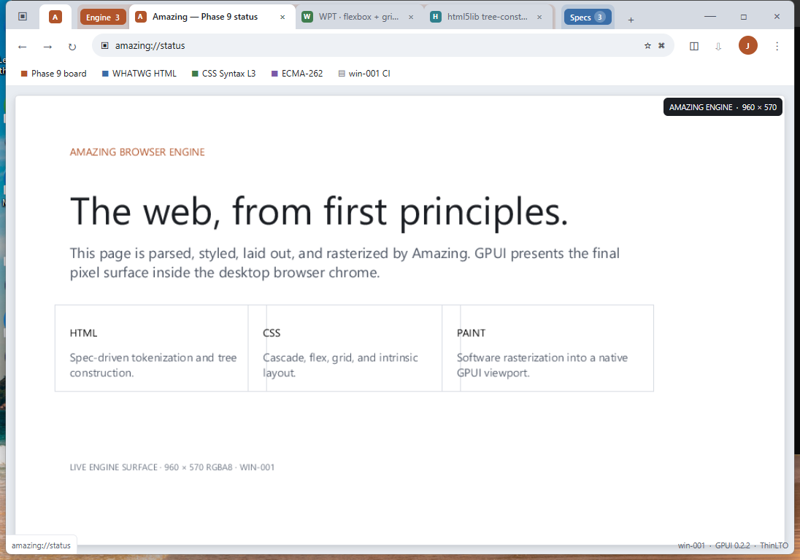
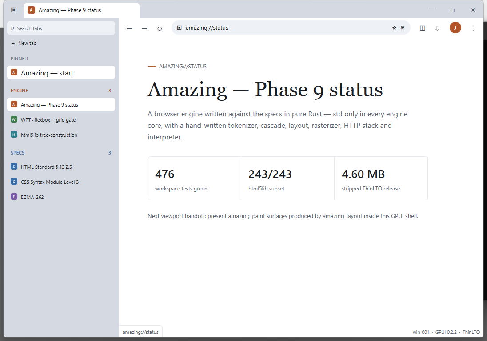
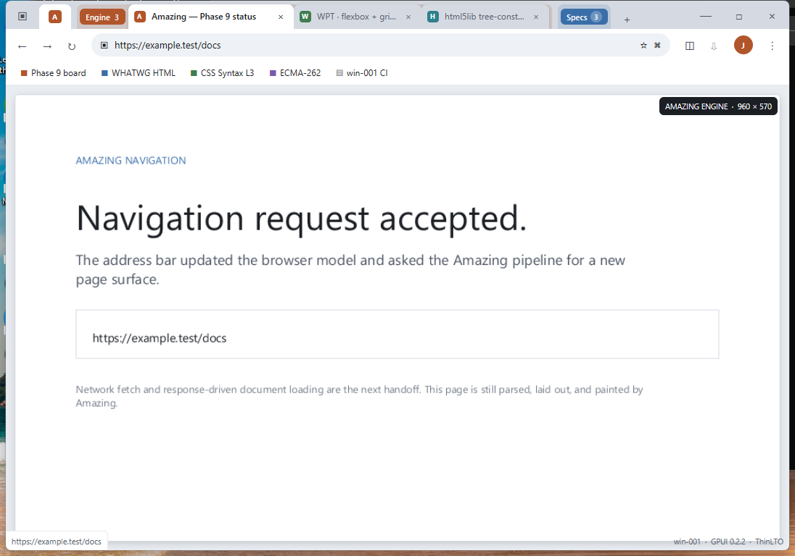

# Amazing GPUI shell

The end-user desktop shell for Amazing, built with Zed's GPUI and isolated
from the std-only engine cores. The pinned GPUI revision provides the native
Windows platform and DirectX renderer.

The current shell slice implements the user-directed visual reference and the
first real engine viewport:

- custom Windows titlebar controls;
- pinned and color-grouped tabs, with a collapsible Specs group;
- back/forward/reload controls and an address surface;
- focused address-bar editing with select-on-click, Backspace, Escape, and
  Enter-to-navigate behavior;
- sidebar-tab mode, bookmarks row, profile and utility controls;
- a live `amazing-layout` → `amazing-paint` RGBA8 page surface, converted to
  GPUI's native BGRA image without crossing the engine-core boundary;
- real TrueType glyph rasterization using the Windows UI font;
- responsive 1080×760 startup bounds for the win-001 RDP desktop.







Build and launch on win-001:

```powershell
cargo build --manifest-path crates\amazing-shell-gpui\Cargo.toml --target-dir target --release --locked
target\release\amazing-shell.exe
# Start directly in the grouped sidebar layout
target\release\amazing-shell.exe --sidebar
```

The shell now proves the full local presentation path from HTML and CSS through
Amazing's layout and software-paint crates into a GPUI image, plus a real
keyboard-driven navigation transition. Network fetch integration, full text
editing/IME behavior, history persistence, scrolling, and a production tab
lifecycle remain the next UI integration steps.
