# Amazing GPUI shell

The end-user desktop shell for Amazing, built with Zed's GPUI and isolated
from the std-only engine cores. The pinned GPUI revision provides the native
Windows platform and DirectX renderer.

The current shell slice implements the user-directed visual reference and the
first real engine viewport:

- custom Windows titlebar controls;
- pinned and color-grouped tabs, with a collapsible Specs group;
- real per-tab state: New Tab and Close work, each tab retains its own rendered
  page and branch-aware navigation history, and bookmark shortcuts reopen
  closed tabs;
- back/forward/reload controls and an address surface;
- focused address-bar editing with select-on-click, Backspace, Escape, and
  Enter-to-navigate behavior, plus Chrome-style URL detection and search-query
  fallback and Ctrl+A/C/X/V clipboard editing;
- interactive bookmark, Downloads, site-information, and main-menu surfaces;
  every visible main-menu item performs its stated action;
- functional title-bar and toolbar side-panel toggles plus a local-profile
  surface that accurately reports device-local browsing state;
- Chrome keyboard behavior across the shell: Ctrl+L/F6 focuses the address
  bar, Ctrl+T/W creates and closes tabs, Ctrl+R/F5 reloads, Alt+Left/Right
  traverses per-tab history, Ctrl+J opens Downloads, and Escape dismisses
  transient chrome;
- sidebar-tab mode, bookmarks row, profile and utility controls;
- a live `amazing-layout` → `amazing-paint` RGBA8 page surface, converted to
  GPUI's native BGRA image without crossing the engine-core boundary;
- response-driven HTML for `file://` and plain `http://` navigation, including
  ordered inline/external stylesheet collection and explicit in-viewport fetch
  errors;
- verified HTTPS navigation plus bounded PNG/JPEG/GIF/WebP/ICO image loading
  through the layout and paint resource seams;
- layout-derived painted-link hit regions with real relative navigation from
  the GPUI viewport;
- native text-input focus/edit overlays and encoded GET form submission;
- bounded inline/external classic-script execution against the arena DOM before
  relayout and repaint;
- per-tab retained DOM/interpreter state with post-paint click dispatch,
  `preventDefault`, future timer turns, and automatic repaint;
- content-height painting up to the engine safety cap and native GPUI wheel
  scrolling while browser chrome stays fixed;
- a native media tab that encodes H.264, decodes I420, converts to RGBA, and
  presents the resulting 320×180 frame through GPUI;
- six statefully encoded/decoded frames driven by an absolute presentation
  clock; its 16–5000 ms waits target audio-master-relative deadlines and a late
  wake catches up without accumulating drift;
- `--secure-video` launches the root DTLS-SRTP driver, validates versioned AMV2
  RGBA records and strictly increasing RTCP-derived presentation times on a
  background localhost reader, progressively presents each frame after its
  per-packet jitter/assembly/H.264 decode path, then seals the six-frame replay
  timeline at EOF;
- the reader/UI handoff is a bounded three-event synchronous channel, so a slow
  renderer backpressures TCP instead of growing decoded-frame memory;
- a presentation discontinuity after an actual missing RTP sequence records one
  authenticated PLI/forced-IDR recovery in the native status surface;
- AMA3 carries bounded decoded Opus PCM into an isolated WinMM `waveOut`
  adapter; its hardware-consumed sample cursor drives the GPUI video clock;
- real TrueType glyph rasterization using the Windows UI font;
- responsive 1080×760 startup bounds for the win-001 RDP desktop.


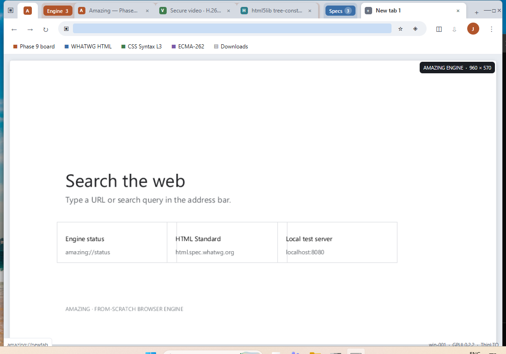

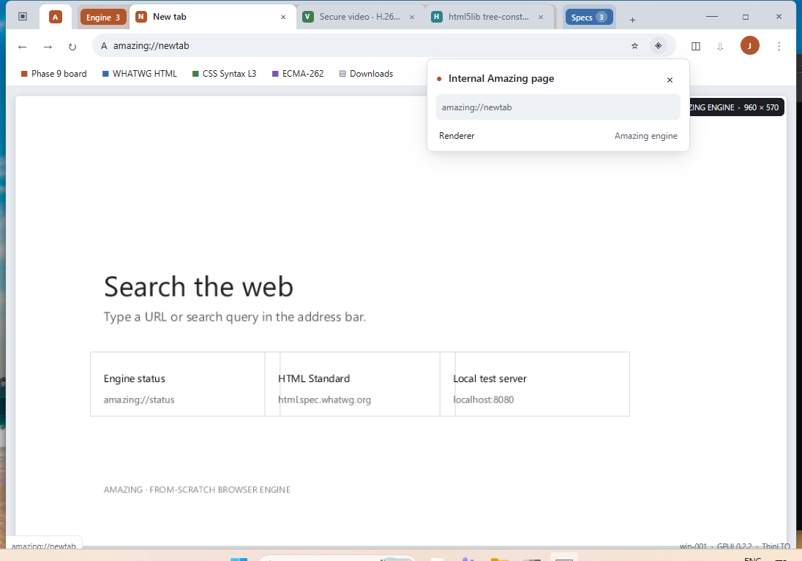

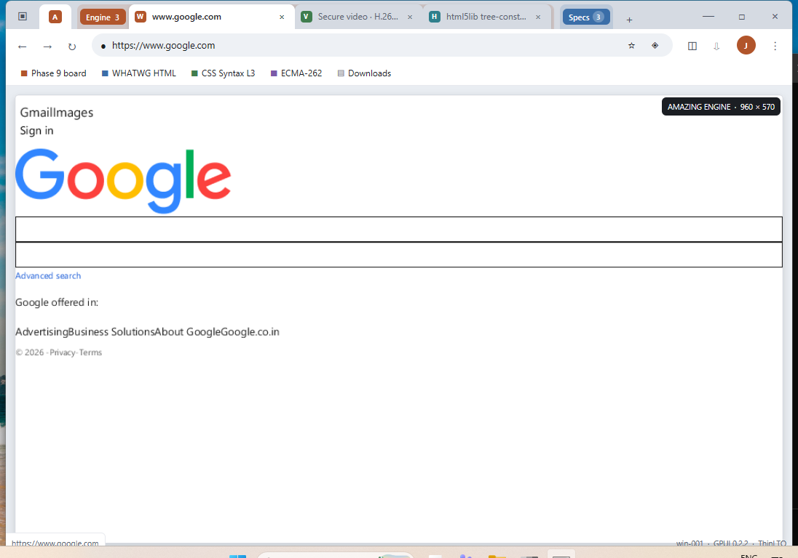

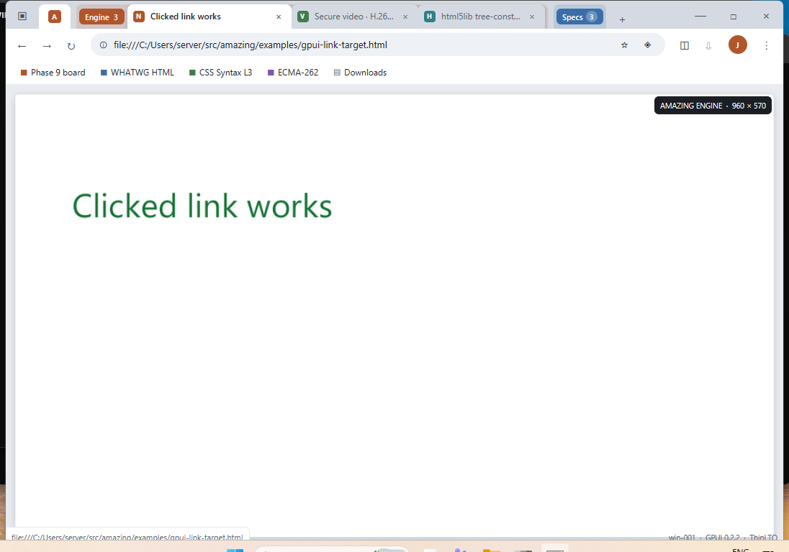

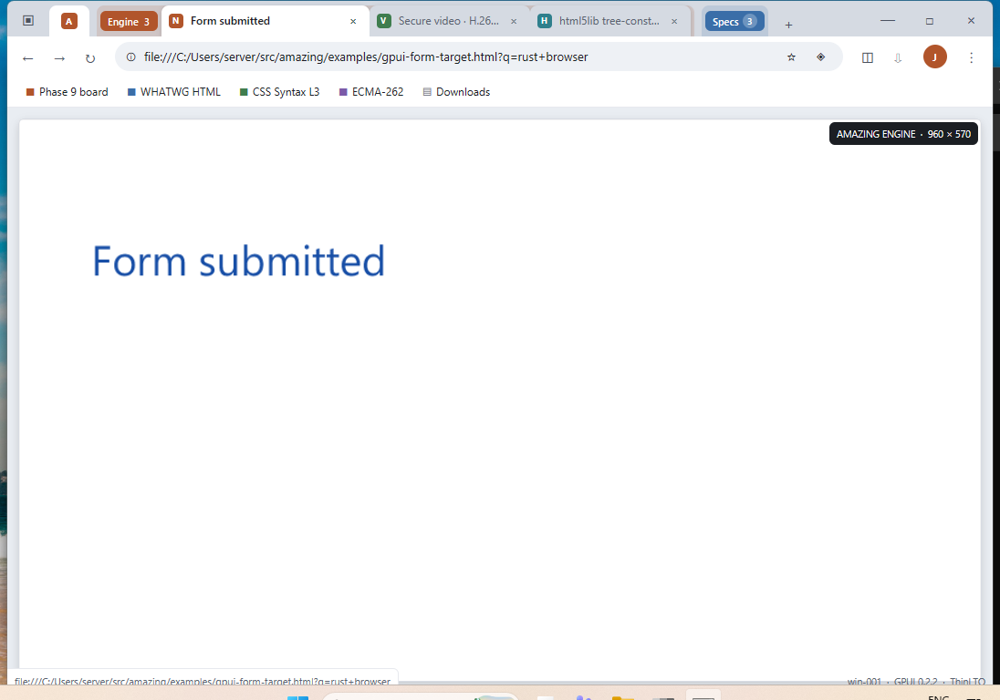

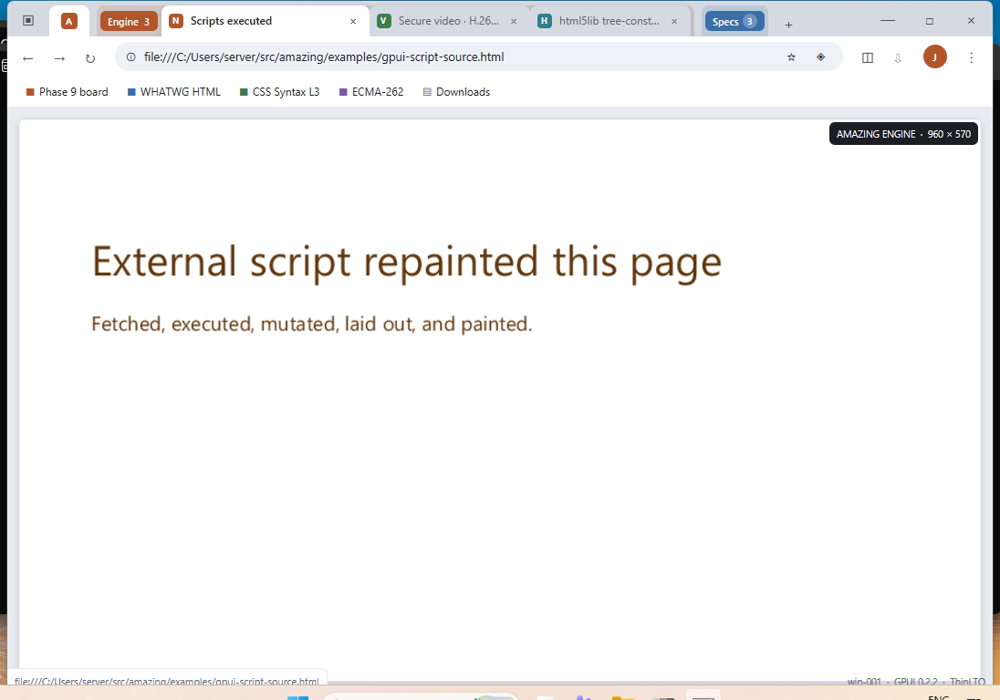

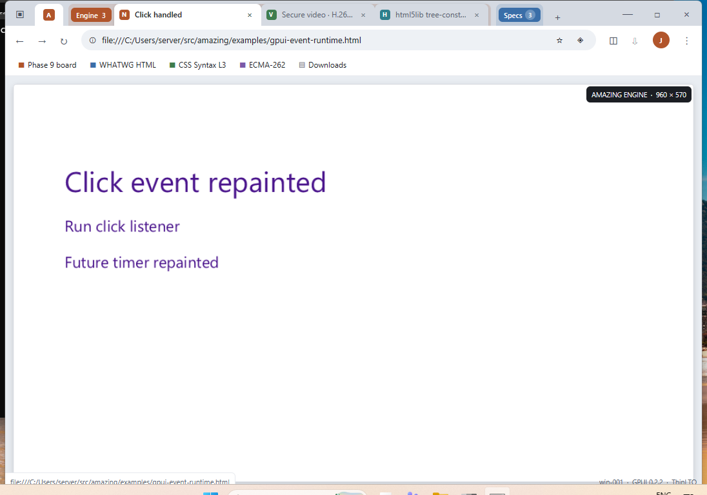


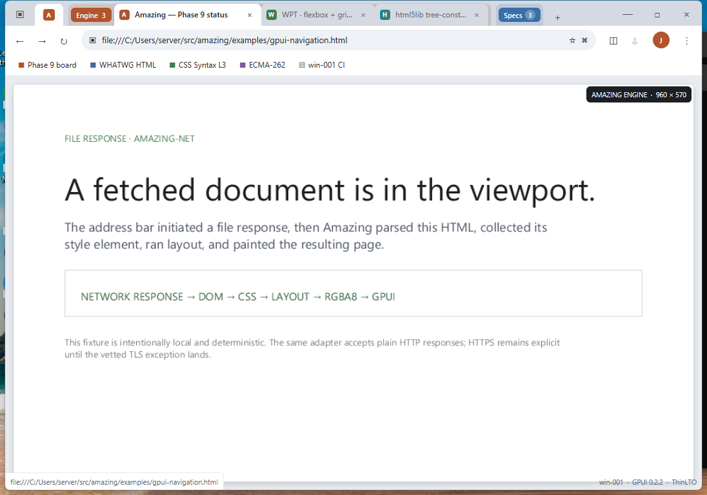

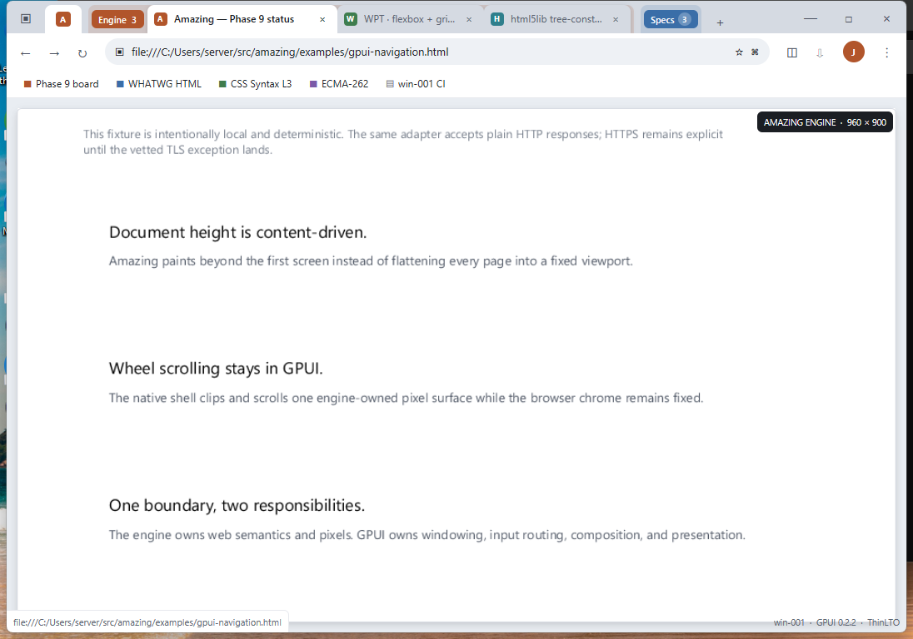

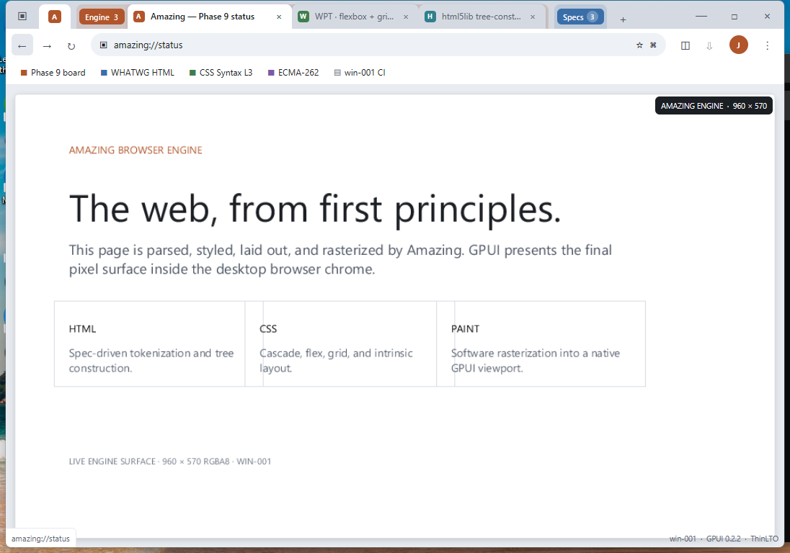

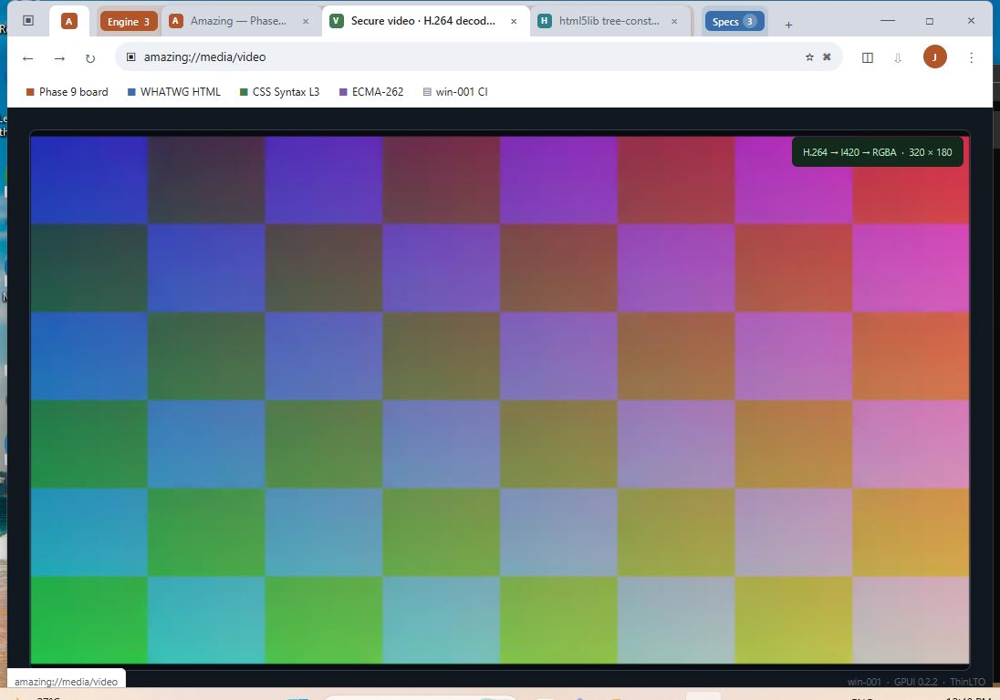

Animated proof: [frame A](../../docs/screenshots/gpui-video-frame-a-win001.png)
and [frame B](../../docs/screenshots/gpui-video-frame-b-win001.png).

Direct secure proof: [frame A](../../docs/screenshots/gpui-secure-video-win001.png)
and [frame B](../../docs/screenshots/gpui-secure-video-b-win001.png).

RTP-clock proof: [frame A](../../docs/screenshots/gpui-rtp-clock-a-win001.png)
and [frame B](../../docs/screenshots/gpui-rtp-clock-b-win001.png).

RTCP A/V-clock proof: [frame A](../../docs/screenshots/gpui-rtcp-av-clock-a-win001.png)
and [frame B](../../docs/screenshots/gpui-rtcp-av-clock-b-win001.png).

Absolute-deadline proof: [frame A](../../docs/screenshots/gpui-absolute-clock-a-win001.png)
and [frame B](../../docs/screenshots/gpui-absolute-clock-b-win001.png).

Progressive-delivery proof: [frame 1](../../docs/screenshots/gpui-live-stream-a-win001.png)
and [frame 2](../../docs/screenshots/gpui-live-stream-b-win001.png).

Incremental-decode proof: [frame 1](../../docs/screenshots/gpui-incremental-decode-a-win001.png)
and [frame 2](../../docs/screenshots/gpui-incremental-decode-b-win001.png).

Bounded-queue proof: [complete session](../../docs/screenshots/gpui-bounded-queue-win001.png).

PLI/IDR recovery proof: [complete session](../../docs/screenshots/gpui-pli-recovery-win001.png).

RTP-loss recovery proof: [complete session](../../docs/screenshots/gpui-rtp-loss-recovery-win001.png).

Audio-device clock proof: [cursor A](../../docs/screenshots/gpui-audio-clock-a-win001.png)
and [cursor B](../../docs/screenshots/gpui-audio-clock-b-win001.png).

Build and launch on win-001:

```powershell
# From the workspace root, this launches a prebuilt GPUI shell or builds the
# isolated locked shell crate when needed.
cargo run

# Direct shell build/run commands remain available.
cargo build --manifest-path crates\amazing-shell-gpui\Cargo.toml --target-dir target --release --locked
target\release\amazing-shell.exe
# Start directly in the grouped sidebar layout
target\release\amazing-shell.exe --sidebar
# Start directly on the decoded-video media tab
target\release\amazing-shell.exe --video
# Launch the real secure two-process session and display its decoded frames
target\release\amazing-shell.exe --secure-video
```

The shell now proves the full local presentation path from address input through
Amazing's file/HTTP/HTTPS response layer, DOM, ordered stylesheet and image
resource loading, layout, and software paint into a GPUI image. Full text
editing/IME behavior, history persistence, and a production tab lifecycle
remain next UI integration steps. The ordered plan lives in
[`docs/BROWSING_TODO.md`](../../docs/BROWSING_TODO.md).
